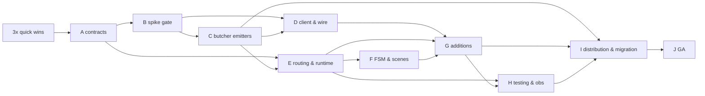

# aiogram 4.0 — implementation plans

Decomposition of [`../research/`](../research/README.md) into PR-sized tasks. Status: **planned, nothing implemented**
(2026-11-17).

- **One plan file = one reviewable PR** (S ≤1 day, M 2–3 days, L 4–5 days). Files follow [`_TEMPLATE.md`](_TEMPLATE.md).
- **Every plan is self-contained.** Hand a single file to a fresh session as its only instruction, or run it as one
  step of an orchestrated workflow (see [Running plans](#running-plans)).
- **Normative order of sources:** owner decisions in this README (§1) → [19-review-resolutions](../research/19-review-resolutions.md)
  → the other research pages. §1 records planning-time owner decisions that **revise** research pages; task
  [A-02](A-contracts/A-02-apply-resolutions.md) folds them into the research pages.
- **Gate-conditional** plans assume milestone B passes (D104). If [B-13](B-spike/B-13-gate-run-and-decision.md) is a
  no-go, every gate-conditional plan becomes `blocked` and is re-planned; see the void list in B-13. The field
  describes the plan's **own** design: a `no` plan that depends on a gate-conditional plan is still not ready until
  that dependency is done (its *Workflow notes* say which parts can start earlier).

## 1. Planning decisions (normative for all plans)

Owner = confirmed by the owner on 2026-11-17. Default = planning default; owner may override, then update the affected plans.

| # | Decision | By | Revises |
|---|---|---|---|
| PD-01 | The full D121 feature set (A–J incl. G and H) blocks 4.0 GA | Owner | — |
| PD-02 | D100 (every generated signature keyword-only) kept as decided | Owner | — |
| PD-03 | Spike code lands on `dev-4.x`, **not wired** into `aiogram.types` (3.x pydantic package untouched beside it); a no-go reverts the spike directories | Owner | — |
| PD-04 | **Depends teardown runs inside the isolation scope**: after `errors` handlers, before the FSM isolation lock is released | Owner | D112 "after the whole update" (03 §5) |
| PD-05 | D48 bubbling: at snapshot compile, **warn** when a router has `errors` handlers but no handler routers beneath it; the migration checker flags the same pattern | Owner | — |
| PD-06 | **Single-bot thread sharding ships in 4.0** (one bot's updates spread over N Runner threads by isolation key, 07 §1 / 12 §3) | Owner | 4.x-plan "Deferred out of 4.0" |
| PD-07 | D117 narrowed: the i18n context is captured **when a handler returns a method and when `bot(method)` is called**; method constructors stay i18n-free | Owner | D117 "a method created inside an update" |
| PD-08 | Session `json_loads`/`json_dumps` **do not affect Bot API wire** (requests, responses, update decoding always use the Rust codec); the session params are deprecated. FSM storages keep their own codec hooks | Owner | 05 §2.3 fast-path condition |
| PD-09 | Redis/Mongo storages are **single-loop** in 4.0: use from a second loop raises a clear error; multi-Runner / sharded deployments with Redis/Mongo are documented as unsupported in 4.0 (see F-06 Notes for the interaction with PD-06) | Owner | — |
| PD-10 | butcher `import-legacy` is a **throwaway Python script** (ast + PyYAML) behind the `cargo xtask butcher import-legacy` shim, kept runnable in "diff against current overlay" mode until 3.x full support ends | Owner | 02 §3 (Rust) |
| PD-11 | `timedelta` in DateTime fields encodes as **`now + delta` (absolute unix time)**, as 3.x does. "timedelta as seconds" in 13 B17 / 05 §2.1 / 01 §3.1 is a bug (temporary bans would become permanent) | Default | 13 B17, 05, 01 |
| PD-12 | The behaviour oracle is an **external pinned 3.x venv**; 4.0 carries no in-tree reference path. Corpus, bench harness and oracles are authored on `dev-3.x` (needed for D120 per-PR measurement) and merged forward | Default | README milestone A wording |
| PD-13 | **One migration registry**: a data file `aiogram/_migration/registry.toml` read by path (no `_core` import, so docs and `uvx aiogram[migrate]` stay import-free). Ids `AG4xxx`, append-only; kinds `removal-4.0`, `deprecation-4.x`, `api-ledger` (generated). Schema + seed: A-11; 3.x warnings: 3x-20; 4.x machinery/CI/docs page: I-12. Every plan with a user-visible break adds its entry | Default | 18 §2 `registry.py` |
| PD-14 | Token-safe errors: 4.x wraps aiohttp errors `from None`, original on `.original` (D-03). H owns only the log filters | Default | — |
| PD-15 | The **Rust entity-rendering kernel** (UTF-16, HTML/MarkdownV2 unparse) is data plane: owned by D-17. G-08 builds the Python formatting API on it. "parse" in the README architecture box is dropped (no 4.0 consumer) | Default | README box |
| PD-16 | Porting the remaining hand-written type helpers (≈26 methods in 12 classes) to `*_ext.rs` is C-27 | Default | — |
| PD-17 | `API_CALL` spans are **per attempt, inside `RetryMiddleware`**; Retry exposes the attempt number | Default | — |
| PD-18 | `dp.tracers`, `dp.param_resolvers`, `dp.dependency_overrides` and `workflow_data` are **epoch-bumping containers** (mutation invalidates cached snapshots and triggers the D114 warning) | Default | 03 §5 plain list |
| PD-19 | D111 "matched candidate": a router's outer chain is entered iff at least one candidate in its subtree survives the compiled rejectors | Default | — |
| PD-20 | `DefaultBotProperties` becomes `frozen` | Default | — |
| PD-21 | `MemoryStorage`: one dict + one `threading.Lock` (no 64 shards until contention is measured) | Default | 04 §3 |
| PD-22 | FSM storages keep **stdlib `json`** as the default codec; the Rust encoder is opt-in | Default | 04 §3 |
| PD-23 | Keyword-only stubs have **no `**extra`**; D99 unknown kwargs are runtime-only (documented) | Default | — |
| PD-24 | `ErrorReason` member names are pinned in the overlay after first emission; `butcher diff` reports renames | Default | — |
| PD-25 | `idempotent`: new methods default to non-idempotent and `butcher check` requires an explicit decision; raw `bot.call` retries only 429 | Default | — |
| PD-26 | Re-entrant acquisition of the same isolation key in the same task raises `RuntimeError` (turns the breaking-#15 deadlock into an error) | Default | — |
| PD-27 | Tier 1 (D119) = **our** wheels build and **our** suite passes; missing third-party free-threaded wheels are documented, not release-blocking | Default | — |
| PD-28 | 3.x track: 09 #18 dropped (atomicity is a separate 3.x fix); 09 #8 measured or dropped; 09 #21 decodes per update only when the batch fails; behaviour-changing quick wins ship in a 3.x **minor** | Default | 09, D120 |
| PD-29 | Keep `ClientDecodeError` (gains `.raw`) instead of a new `TelegramDecodeError` (D47: no new classes) | Default | 10 Layer 2 |
| PD-30 | The B spike types are **hand-written in emitted shape**; C-18 must reproduce them as a golden diff | Default | 01 §5.1 "prototype butcher" |
| PD-31 | Early prerequisites pulled ahead of their milestone: B-01 (build skeleton), I-12 (registry machinery), H-01/H-02 (logging, redaction), H-05 (trace interface), H-19 (MockedBot port) | Default | README milestone order |
| PD-32 | `force_reply` on keyboard markups is a real Bot API 10.4 field (#1954) and is **kept**; no plan removes or warns about it | Default | 11 §4, 16 §2 |
| PD-33 | Registry authority: `dev-4.x` owns `registry.toml` after the fork; id blocks AG4001–4699 (dev-4.x), AG4700–4799 (first added on dev-3.x), AG4800–4999 (api-ledger); 3x-24 copies the file back before each baseline release (A-11) | Default | PD-12 / PD-13 interplay |
| PD-34 | Embargo: nothing that names or describes an unfixed security issue reaches the public repo before its fix ships. A-01 commits a **redacted** `v4/` (owner, 2026-11-18): plans whose substance is an unfixed fix are held back until released, and are committed after their fix ships; `4.x-plan-for-core-devs.md` stays closed circulation | Owner | — |
| PD-35 | **PyPy is not supported in 4.x** (owner, 2026-11-21): no pp311/pp312 wheels, no PyPy CI leg, no classifier; the migration text says "PyPy is not supported in 4.x; stay on 3.x", and 3.x keeps PyPy until its EOL. Supersedes the PyPy parts of D7, D119 and D20. Evidence: Rust through cpyext is 3–9× slower than pure Python on PyPy (F-08 report-03, 12.5 µs vs 4.1 µs for 20 fields from a dict); PyPy 3.12 only arrived in 8.0 (2026-09) and is beta, with no 3.13+ and no free-threading; orjson, jiter, polars, msgspec and uvloop ship no PyPy wheels, and NumPy and Django 6.0 dropped it. Reversing costs a CI leg plus wheels | Owner | D7, D119 (PyPy parts), D20 |
| PD-36 | **Converter core: Rust now, Rust-only** (F-08, owner 2026-11-21). The per-value work of `aiogram/utils/_converters.py` runs in `aiogram._core` (first version, its API superseded by the redesign below: `ModelSchema`, `KindCore`: dict walker, one-pass JSON bytes via `jiter`, flat codec, `to_json`/`dump`); the Python module keeps the class-creation compiler, `register_converter` (a Python kind called from Rust), `ConversionError` and the API F-09/F-11/F-12 use. **Rust-only because PyPy is dropped from 4.x** (PD-35): no second, Python backend. Median µs, M2 Pro, CPython 3.14.2, Rust / pydantic v2: callback unpack 0.58 / 2.91; 5-field dict 0.41 / 0.62; 5-field JSON 0.65 / 0.71; 20-field JSON 3.80 / 3.75; 20-field dict 2.15 / 2.68 (3.14t within 20%; the earlier pure-Python core: 1.24, 1.37, 2.59, 12.42, 8.53). **Raw-bytes path:** an internal `RedisStorage._get_data_raw` hook only (no public storage contract); typed reads parse the stored bytes in one pass; Memory and Mongo use the dict walker (the redesign below takes the raw paths only with the stdlib `json_loads` / `json_dumps`). **Kinds added:** `set`/`frozenset`, NamedTuple, TypedDict (a plain dict of the keys present), smart `Union` (exact type first, then left to right) with an optional `Discriminator`, a per-field `Converter` instance in `Annotated`; no `Annotated` constraints; `Flag` enums rejected; none of the new kinds has a flat form except a flat per-field converter. **Stubs:** `aiogram/_core/conv.pyi` stays hand-written and `stubtest` checks it in `make lint` (as pydantic-core; pyo3 inspect and pyo3-stub-gen probed, not adopted). **Layout:** one `_core`, converter code in `crates/aiogram-core/src/conv/`; a separate `aiogram-conv` crate measured the same µs and size, −1.2 s incremental release, 2× largest codegen unit — not adopted. The F-08 acceptance line "no `aiogram._core` import" no longer holds: the module needs `_core` by design and imports it on first use. **Redesign (plan-10, owner 2026-11-21):** a shared `ModelBase` (`dataclass_transform`, typed class keywords `rename=` / `converters=` / `frozen=` / `slots=`, a validating constructor) and one annotation resolver feed separate JSON and flat schemas (revises D30 / 04 §7 "one converter table"); no global registry (lookup: field > class map > the type's `__aiogram_converter__` hook along the MRO > built-ins); the Python -> Rust interface is typed constructors (`aiogram._core.conv`, `aiogram/_core/conv.pyi`); one `ConversionError` with all errors (JSON) or the first (unions, flat); `rename` / `Key(load=...)`; `dump_json` in Rust; raw Redis paths only with stdlib `json_loads` / `json_dumps`; native UUID / datetime / date / time / timedelta / Decimal / bytes; a flat (callback) form for datetime / date / time as ISO 8601 basic, no `:` (brief 12). Same-session µs, 3.14, new / previous / pydantic: 5-field JSON 0.48 / 0.68 / 0.73; 20-field JSON 3.39 / 4.45 / 3.87; UUID ×100 load 11.95 / 49.28; `dump_json` 2.11 (dump + `json.dumps` 6.36) / pydantic 3.01 | Owner | 04 §7, 08 §7, 11 §4, F-08, B-10 |

## 2. Stories

| Story | Folder | Branch | Exit gate (README D121) |
|---|---|---|---|
| 3x — 3.x quick wins & migration baseline | [3x-quick-wins/](3x-quick-wins/) | `dev-3.x` | each PR measured against its own baseline; baseline release cut |
| A — Contracts & baselines | [A-contracts/](A-contracts/) | `dev-3.x` → `dev-4.x` | oracle + pinned benchmarks exist before any optimisation |
| B — Model spike | [B-spike/](B-spike/) | `dev-4.x` | **binding go/no-go** (B-13) |
| C — Reproducible butcher | [C-butcher/](C-butcher/) | `dev-4.x` | offline deterministic emit; historical + scenario diffs |
| D — Client & wire | [D-client/](D-client/) | `dev-4.x` | request/response differential with manifests; cancellation tests |
| E — Routing & runtime | [E-runtime/](E-runtime/) | `dev-4.x` | routing differences match decisions; lifecycle fault injection; multi-Runner |
| F — FSM & scenes | [F-fsm/](F-fsm/) | `dev-4.x` | race tests on 3.14t; lost-update limits documented |
| G — User-facing additions | [G-features/](G-features/) | `dev-4.x` | contract tests per feature |
| H — Testing & observability | [H-testing-observability/](H-testing-observability/) | `dev-4.x` | redaction + tracer-failure tests; toolkit uses only public extension points |
| I — Distribution & migration beta | [I-distribution/](I-distribution/) | `dev-4.x` | fresh-machine install + 3→4 migration rehearsal on Tier 1 |
| J — GA | [J-ga/](J-ga/) | `dev-4.x` | no unresolved P1 contract; 3.x dates published |

Story arrows are coarse. Gate-independent work (C adapters/IR, E routing core, F, parts of G/H) starts before B ends;
the per-plan `Depends on` field is authoritative.

## 3. Index

Generated from the plan headers; the plan file is authoritative for dependencies. Gaps in numbering are intentional
(H-03 merged into D-03, I-13 merged into 3x-20..3x-24). Open owner questions: [_DECISIONS.md](_DECISIONS.md).
Verification method and results: [_VERIFICATION.md](_VERIFICATION.md).

<!-- index:start -->
| ID | Title | Status | Gate-cond. | Size | Depends on |
|---|---|---|---|---|---|
| [3x-01](3x-quick-wins/3x-01-polling-poison-isolation.md) | Polling: isolate poison updates instead of stalling | `todo` | no | M | A-03, A-05 |
| [3x-02](3x-quick-wins/3x-02-webhook-poison-200.md) | Webhook: poison updates are logged and answered with 200 | `done` | no | L | A-03 |
| [3x-03](3x-quick-wins/3x-03-magicfilter-inline.md) | Resolve `MagicFilter` inline; backport `blocking(fn)` as the thread escape | `todo` | no | M | A-05, A-10 |
| [3x-04](3x-quick-wins/3x-04-keyboard-builder-add.md) | `KeyboardBuilder`: fix the O(n²) `add()`, cheaper isolated `export()` | `todo` | no | S | A-05 |
| [3x-05](3x-quick-wins/3x-05-memory-storage-get.md) | `MemoryStorage` reads stop creating records | `todo` | no | S | A-05 |
| [3x-06](3x-quick-wins/3x-06-isolation-lock-pruning.md) | `SimpleEventIsolation`: prune unused locks safely | `todo` | no | M | A-05 |
| [3x-07](3x-quick-wins/3x-07-drop-model-rebuild-loop.md) | Import time: drop the import-time `model_rebuild` loop | `todo` | no | M | A-05 |
| [3x-08](3x-quick-wins/3x-08-butcher-literal-tags.md) | Butcher: `Literal["x"]` tag fields; measure-or-drop the `RichTextUnion` field discriminator | `todo` | no | M | A-04, A-05, A-08 |
| [3x-09](3x-quick-wins/3x-09-json-request-body.md) | JSON request body when there are no files | `todo` | no | M | A-05, A-09 |
| [3x-10](3x-quick-wins/3x-10-webhook-json-reply.md) | Webhook: JSON reply when the returned method has no files | `todo` | no | S | 3x-02, 3x-09, A-09 |
| [3x-11](3x-quick-wins/3x-11-prebuilt-middleware-chains.md) | Prebuilt middleware chains with a topology epoch | `todo` | no | M | 3x-03, A-05, A-10 |
| [3x-12](3x-quick-wins/3x-12-small-dispatch-costs.md) | Small per-update dispatch costs | `todo` | no | S | 3x-11, A-05 |
| [3x-13](3x-quick-wins/3x-13-deserialize-no-ssl-context.md) | `deserialize_telegram_object`: no SSL context per call | `todo` | no | S | A-05 |
| [3x-14](3x-quick-wins/3x-14-callback-data-prefix-fast-fail.md) | `CallbackData`: prefix fast-fail before split and validate | `todo` | no | S | A-05 |
| [3x-15](3x-quick-wins/3x-15-dp-update-root-filters.md) | `dp.update.filter` root filters are actually checked (and the rest of the filter-correctness bundle) | `done` | no | M | — |
| [3x-16](3x-quick-wins/3x-16-redis-update-data.md) | Redis one-round-trip `update_data` (dropped) | `dropped` | no | — | — |
| [3x-17](3x-quick-wins/3x-17-formatting-perf.md) | Formatting performance (`Text.render`, `_unparse_entities`) and the entity reference corpus | `todo` | no | M | A-04, A-05 |
| [3x-18](3x-quick-wins/3x-18-unknown-union-fallback.md) | `Unknown` fallback variant for discriminated unions (optional) | `todo` | no | L | 3x-01, 3x-02, A-08, A-11 |
| [3x-19](3x-quick-wins/3x-19-token-leak-fix.md) | Stop leaking the bot token through network/download errors (ANT-2026-4GL80S7S) | `done` | no | M | — |
| [3x-20](3x-quick-wins/3x-20-deprecation-machinery.md) | Deprecation machinery backport (warning classes, filter, registry reader) | `todo` | no | M | A-11 |
| [3x-21](3x-quick-wins/3x-21-import-attribute-warnings.md) | Import- and attribute-level warnings for 4.0 removals | `todo` | no | L | 3x-20, A-11 |
| [3x-22](3x-quick-wins/3x-22-registration-warnings.md) | Registration- and class-creation-time warnings | `todo` | no | M | 3x-20, 3x-21, A-11 |
| [3x-23](3x-quick-wins/3x-23-mutation-ledger-warnings.md) | Mutation warnings and Bot API ledger-field warnings | `todo` | no | L | 3x-20, A-05, A-11, C-26 |
| [3x-24](3x-quick-wins/3x-24-migration-baseline-release.md) | Name and cut the migration-baseline 3.x release; "Preparing for 4.0" page | `todo` | no | M | 3x-20, 3x-21, 3x-22, 3x-23, A-11, C-26 |
| [A-01](A-contracts/A-01-bootstrap-dev-4x.md) | Bootstrap `dev-4.x`, commit the planning tree, define the sync policy | `done` | no | S | — |
| [A-02](A-contracts/A-02-apply-resolutions.md) | Apply the review resolutions (19) and planning decisions (PD-01..PD-34) to the research pages | `done` | no | M | A-01 |
| [A-03](A-contracts/A-03-poison-update-decision.md) | Decision record: 3.x poison-update boundaries (owner sign-off required) | `done` | no | S | — |
| [A-04](A-contracts/A-04-pinned-corpus.md) | Pinned corpus and payload manifest | `done` | no | M | — |
| [A-05](A-contracts/A-05-bench-harness.md) | Benchmark harness and method | `todo` | no | M | A-04 |
| [A-06](A-contracts/A-06-record-3x-baselines.md) | Record the 3.x baselines (stock + "optimised 3.x" tag) | `todo` | no | S | 3x-01, 3x-03, 3x-07, 3x-08, 3x-09, 3x-11, 3x-12, 3x-14, A-04, A-05 |
| [A-07](A-contracts/A-07-differential-framework.md) | Differential harness framework (two venvs, canonical traces, difference manifests, poison control) | `todo` | no | M | A-04 |
| [A-08](A-contracts/A-08-model-oracle.md) | Model oracle, 3.x side | `todo` | no | M | A-04, A-07 |
| [A-09](A-contracts/A-09-request-oracle.md) | Request/response oracle, 3.x side | `todo` | no | M | A-04, A-07 |
| [A-10](A-contracts/A-10-routing-oracle.md) | Routing oracle, 3.x side | `todo` | no | L | A-04, A-07 |
| [A-11](A-contracts/A-11-migration-registry.md) | Migration registry: `registry.toml` schema, id allocation, seed | `done` | no | M | A-01 |
| [B-00](B-spike/B-00-freeze-gate-spec.md) | Freeze the gate spec | `todo` | no | M | A-04, A-05, A-06 |
| [B-01](B-spike/B-01-crate-maturin-skeleton.md) | Crate + maturin skeleton + minimal CI | `done` | no | M | A-01 |
| [B-02](B-spike/B-02-bench-adapter-memory-estimator.md) | Bench harness 4.0 adapter + memory estimator | `todo` | no | M | A-04, A-05, A-06, B-00, B-01 |
| [B-03](B-spike/B-03-decode-runtime.md) | Decode runtime core: field tables, value kinds, sparse layout | `done` | no | M | B-01 |
| [B-04](B-spike/B-04-spike-type-set.md) | Spike type set (hand-written in emitted shape) | `todo` | no | L | B-00, B-03, B-14 |
| [B-05](B-spike/B-05-views-cache-gc-routing-keys.md) | Python views, wrapper cache, GC, `routing_keys()` | `todo` | no | L | B-04 |
| [B-06](B-spike/B-06-value-semantics-native-api.md) | Value semantics + native serialization API | `todo` | no | M | B-05 |
| [B-07](B-spike/B-07-bound-views.md) | Bound views (D103) | `todo` | no | S | B-05, B-06 |
| [B-08](B-spike/B-08-subclassing-register.md) | Subclassing + `register` | `todo` | no | M | B-05, B-06 |
| [B-09](B-spike/B-09-sendmessage-encoder-response.md) | `SendMessage` + encoder + response path | `todo` | no | L | B-01, B-04, B-05, B-06, B-07, B-14 |
| [B-10](B-spike/B-10-ext-helpers-stub-workflow.md) | `*_ext.rs` helpers + stub workflow | `todo` | no | M | B-01, B-05 |
| [B-11](B-spike/B-11-cache-gc-teardown-ft-tests.md) | Cache / GC / teardown / free-threading tests | `todo` | no | M | B-01, B-05, B-06, B-07, B-08, B-09 |
| [B-12](B-spike/B-12-dispatch-harness.md) | End-to-end dispatch harness | `todo` | no | M | A-06, A-10, B-00, B-02, B-05, B-07, B-09 |
| [B-13](B-spike/B-13-gate-run-and-decision.md) | Gate run + go/no-go decision record | `todo` | no | M | A-06, A-08, B-00, B-01, B-02, B-03, B-04, B-05, B-06, B-07, B-08, B-09, B-10, B-11, B-12, B-14 |
| [B-14](B-spike/B-14-unions-envelope-batch-decode.md) | Decode runtime: unions, depth guard, response envelope, `getUpdates` batch | `todo` | no | M | B-03 |
| [C-01](C-butcher/C-01-crate-xtask-ir-snapshot.md) | butcher crate, xtask entry point, IR model, snapshot format | `done` | no | M | A-01, B-01 |
| [C-02](C-butcher/C-02-fetch-provenance.md) | `fetch`, source cache and manifest provenance | `todo` | no | S | C-01 |
| [C-03](C-butcher/C-03-html-adapter.md) | HTML adapter | `todo` | no | L | C-01 |
| [C-04](C-butcher/C-04-openapi-adapter.md) | OpenAPI 3.2 adapter | `todo` | no | L | C-01 |
| [C-05](C-butcher/C-05-errors-json-adapter.md) | `errors.json` adapter | `done` | no | S | C-01 |
| [C-06](C-butcher/C-06-overlay-schema-loader.md) | Overlay schema and loader | `todo` | no | M | C-01 |
| [C-07](C-butcher/C-07-fill-dsl.md) | Fill-DSL for shortcuts | `todo` | no | M | C-06 |
| [C-08](C-butcher/C-08-merge-cross-check.md) | Merge and cross-check | `todo` | no | L | C-03, C-04, C-05, C-06 |
| [C-09](C-butcher/C-09-resolution-passes.md) | Resolution passes: D18 twins, D109 names, union classification | `todo` | no | M | C-08 |
| [C-10](C-butcher/C-10-ledger-diff.md) | Compat ledger and `butcher diff` | `todo` | no | M | A-11, C-01, C-08 |
| [C-11](C-butcher/C-11-import-legacy.md) | `import-legacy`: throwaway Python migration of `.butcher/` YAML | `todo` | no | M | C-06, C-07, C-10 |
| [C-12](C-butcher/C-12-enums-error-reason-emitter.md) | Python enums and `ErrorReason` emitter | `todo` | no | M | C-05, C-09, C-11 |
| [C-13](C-butcher/C-13-reexport-modules.md) | Per-type / per-method re-export modules and `__init__` (D16) | `todo` | partial | S | C-09 |
| [C-14](C-butcher/C-14-pyi-stub-emitter.md) | `.pyi` stub emitter | `todo` | yes | L | B-06, B-10, C-09, C-10, C-13 |
| [C-15](C-butcher/C-15-bot-methods-emitter.md) | `_BotMethods` mixin emitter | `todo` | no | M | C-09, C-10 |
| [C-16](C-butcher/C-16-router-observers-update-tables.md) | Router observers mixin and update tables (Python) | `todo` | no | S | C-09 |
| [C-17](C-butcher/C-17-utility-signature-emitter.md) | Builder and utility signature emitter (D59) | `todo` | no | M | C-09 |
| [C-18](C-butcher/C-18-rust-type-emitter.md) | Rust type emitter (data, decode tables, views) | `todo` | yes | L | B-03, B-04, B-05, B-06, B-07, B-13, B-14, C-09, I-12 |
| [C-19](C-butcher/C-19-rust-forward-compat-emitter.md) | Rust forward-compat emitter: unions, `Unknown…`, enums, `Update.event_type` | `todo` | yes | M | B-04, B-13, B-14, C-18 |
| [C-20](C-butcher/C-20-rust-methods-shortcuts-emitter.md) | Rust methods, encoder tables, shortcuts, `send_copy`, method metadata | `todo` | yes | L | B-09, B-13, C-07, C-10, C-11, C-18, I-12 |
| [C-21](C-butcher/C-21-generated-tests-emitter.md) | Generated-tests emitter | `todo` | yes | M | A-04, C-18, C-19, C-20 |
| [C-22](C-butcher/C-22-docs-rst-emitter.md) | Docs `.rst` index emitter | `todo` | no | S | C-09 |
| [C-23](C-butcher/C-23-check-offline-determinism.md) | `butcher check`, offline determinism and the PR CI job | `todo` | no | M | C-10, C-12, C-13, C-15, C-16, C-17, I-05 |
| [C-24](C-butcher/C-24-scheduled-online-reextract.md) | Scheduled online re-extract job | `todo` | no | S | C-02, C-08, C-11 |
| [C-25](C-butcher/C-25-historical-scenario-tests.md) | Historical diff and scenario tests (milestone C exit gate) | `todo` | partial: the `send_copy` and generated-runtime scenarios need C-20/C-21 | M | C-08, C-09, C-10, C-11, C-20, C-21, C-23 |
| [C-26](C-butcher/C-26-removal-inventory-signature-table.md) | 4.0 removal inventory and 3.x signature table | `todo` | no | S | A-11 |
| [C-27](C-butcher/C-27-port-ext-helpers.md) | Port the remaining hand-written type helpers to `*_ext.rs` | `todo` | yes | M | B-10, B-13, C-18, D-17 |
| [D-01](D-client/D-01-default-bot-properties-and-bot-cleanup.md) | Frozen `DefaultBotProperties`, `Bot` cleanup, `Bot.__repr__` | `todo` | no | S | A-01, A-11, C-15 |
| [D-02](D-client/D-02-exceptions-error-reason-restarting-removal.md) | Exceptions: `ErrorReason` on `e.reason`, `RestartingTelegram` removal, `ClientDecodeError.raw` | `todo` | no | M | A-01, A-11, C-12 |
| [D-03](D-client/D-03-token-safe-network-errors.md) | Token-safe network errors (`from None`, `.original`, redacted URLs) | `todo` | no | S | A-01, A-11 |
| [D-04](D-client/D-04-drop-aiofiles-input-file-replayable.md) | Drop `aiofiles`; add `InputFile.replayable` | `todo` | no | S | A-01, A-11 |
| [D-05](D-client/D-05-download-lifecycle.md) | Download lifecycle: per-phase timeouts, `bot.stream()`, typed overloads | `todo` | no | M | D-03, D-04 |
| [D-06](D-client/D-06-request-middleware-manager.md) | Request middleware manager: prebuilt chain, `before=`/`after=` anchors, per-call request context | `todo` | no | S | A-01, H-01 |
| [D-07](D-client/D-07-rust-encoder-json.md) | Rust encoder: JSON request body, `Default` resolution, value rules | `todo` | yes | L | B-01, B-09, B-13, C-20, C-21, D-01 |
| [D-08](D-client/D-08-rust-encoder-multipart.md) | Rust encoder: multipart bodies and file extraction | `todo` | yes | M | B-01, B-09, B-13, C-20, D-04, D-07 |
| [D-09](D-client/D-09-response-decoder.md) | Response decoder: `Response[T]` without pydantic, `getUpdates` per-update isolation | `todo` | yes | L | B-01, B-09, B-13, B-14, C-18, C-19, C-20, D-02 |
| [D-10](D-client/D-10-request-snapshot-and-render-hook.md) | Request snapshot and lazy-text render hook (context captured at return and at call) | `todo` | yes | M | B-01, B-09, B-13, D-04, D-06, D-07, D-08 |
| [D-11](D-client/D-11-session-on-new-codec.md) | `BaseSession` / `AiohttpSession` on the Rust codec | `todo` | yes | L | D-01, D-02, D-03, D-06, D-07, D-08, D-09, D-10, H-19, I-12 |
| [D-12](D-client/D-12-custom-session-hook-compatibility.md) | Custom-session hook compatibility (`prepare_value`, `check_response`, third-party sessions) | `todo` | yes | M | D-11 |
| [D-13](D-client/D-13-raw-bot-call-raw-method.md) | Raw `bot.call(...)` and internal `RawMethod` | `todo` | yes | M | B-01, B-13, C-20, D-07, D-08, D-09, D-11 |
| [D-14](D-client/D-14-webhook-reply-encoding.md) | Webhook reply encoding (JSON / multipart) and `deserialize_telegram_object` on the encoder | `todo` | yes | M | D-01, D-07, D-08, D-10 |
| [D-15](D-client/D-15-request-response-differential-cases.md) | Request/response differential cases with difference manifests (D exit gate, part 1) | `todo` | yes | M | A-07, A-09, D-07, D-08, D-09, D-11, D-12, D-13 |
| [D-16](D-client/D-16-cancellation-resource-tests.md) | Cancellation and resource tests for uploads and downloads (D exit gate, part 2) | `todo` | yes | M | D-03, D-04, D-05, D-08, D-11 |
| [D-17](D-client/D-17-rust-entity-rendering-kernel.md) | Rust entity-rendering kernel: UTF-16 offsets, HTML/MarkdownV2 unparse and quoting | `todo` | yes | L | 3x-17, B-01, B-10, B-13 |
| [E-01](E-runtime/E-01-dispatcher-filter-removals.md) | Dispatcher and filter legacy removals | `todo` | no | M | A-01, A-11 |
| [E-02](E-runtime/E-02-dispatch-table-executor.md) | Compiled `DispatchTable` and executor | `todo` | no | L | A-01, A-07, A-10, H-01 |
| [E-03](E-runtime/E-03-snapshot-lifecycle.md) | Routing snapshot lifecycle: topology epoch, caching, refresh, mutation warning | `todo` | no | M | E-02 |
| [E-04](E-runtime/E-04-router-graph-multi-parent-flags.md) | Router graph: multiple parents, diamond check, router-level flags | `todo` | no | M | E-02 |
| [E-05](E-runtime/E-05-typed-observers-unknown-update.md) | Generated typed observers and the `unknown_update` observer | `todo` | no | S | C-16, E-03 |
| [E-06](E-runtime/E-06-middleware-api.md) | Middleware API: ordering anchors, per-handler middlewares, generic `BaseMiddleware` | `todo` | no | M | E-02 |
| [E-07](E-runtime/E-07-sync-filter-execution.md) | Sync filter execution: `SyncFilterMode`, `inline()` / `blocking()`, dict-overwrite warning | `todo` | no | S | 3x-03, E-02 |
| [E-08](E-runtime/E-08-magic-filter-compile.md) | Compile `F` expressions to closures | `todo` | no | M | E-07 |
| [E-09](E-runtime/E-09-routing-keys-compiled-rejectors.md) | Routing keys and compiled rejectors (prefilter, literal and command index) | `todo` | **yes** | L | B-05, B-13, C-16, C-19, E-02, E-08 |
| [E-10](E-runtime/E-10-flag-spec.md) | Typed flag specs (`@flag_spec`) | `todo` | no | S | E-04 |
| [E-11](E-runtime/E-11-error-model-bubbling.md) | Error model: `ErrorEvent` fields, phases, bubbling, update-scope hooks | `todo` | no | M | A-11, C-12, E-02, E-04, F-03 |
| [E-12](E-runtime/E-12-runtime-errors.md) | `dp.runtime_errors` observer | `todo` | no | S | E-11 |
| [E-13](E-runtime/E-13-runner-lifecycle-bot-registry.md) | `Runner`: lifecycle state machine, sources, task set | `todo` | no | M | E-03, E-12, H-01 |
| [E-14](E-runtime/E-14-feed-paths-forward-compat-dispatch.md) | Feed paths (`runner.feed` / `runner.process`, `dp.feed_update`) and forward-compatible dispatch | `todo` | partial | M | B-07, C-19, D-09, D-10, E-05, E-11, E-12, E-13, H-01 |
| [E-15](E-runtime/E-15-poller.md) | `Poller` update source | `todo` | no | M | D-09, D-11, E-05, E-14 |
| [E-16](E-runtime/E-16-webhook-core-aiohttp-sources.md) | Webhook core and aiohttp sources | `todo` | no | L | D-09, D-10, D-14, E-14, E-23 |
| [E-17](E-runtime/E-17-asgi-app.md) | ASGI webhook app | `todo` | no | S | D-14, E-14, E-16 |
| [E-18](E-runtime/E-18-compat-wrappers.md) | 3.x entry points as Runner wrappers | `todo` | no | S | E-15, E-16 |
| [E-19](E-runtime/E-19-multi-runner-free-threading-sharding.md) | Multi-Runner over one Dispatcher and free-threading | `todo` | no | M | E-03, E-13, E-15, E-23, F-02 |
| [E-20](E-runtime/E-20-typed-di-typeddicts.md) | Typed DI: base `TypedDict`s for handler and middleware data | `todo` | no | S | E-01 |
| [E-21](E-runtime/E-21-e-exit-gate.md) | Milestone E exit gate: routing differential, benchmarks, lifecycle and multi-Runner matrices | `todo` | partial | M | A-05, A-06, A-07, A-10, E-01, E-02, E-03, E-04, E-05, E-06, E-07, E-08, E-09, E-10, E-11, E-12, E-13, E-14, E-15, E-16, E-17, E-18, E-19, E-20, E-22, E-23 |
| [E-22](E-runtime/E-22-single-bot-sharding.md) | Single-bot thread sharding (ingress Poller, per-worker queues) | `todo` | no | M | E-15, E-19, F-02, F-04 |
| [E-23](E-runtime/E-23-bot-registry.md) | Runner bot registry: `add_bot` / `remove_bot`, `bot_added` / `bot_removed`, shared-FSM ownership | `todo` | no | M | E-12, E-13 |
| [F-01](F-fsm/F-01-thread-safe-memory-storage.md) | Thread-safe `MemoryStorage` (one dict + one lock) | `todo` | no | M | A-01, A-05, A-11 |
| [F-02](F-fsm/F-02-isolation-lock-table-default-on.md) | Cross-thread, cross-loop isolation lock table, on by default (D28) | `todo` | no | L | A-01, A-05, A-06, A-11, H-01 |
| [F-03](F-fsm/F-03-release-isolation-warn-after.md) | `state.release_isolation()`, `isolation_warn_after`, release hooks, re-entrancy error | `todo` | no | M | A-11, F-02, H-01 |
| [F-04](F-fsm/F-04-fsm-hot-paths-statefilter.md) | FSM hot paths, StateFilter introspection, public isolation-key function | `done` | no | S | A-01, A-05 |
| [F-05](F-fsm/F-05-storage-record-batch-api.md) | Storage record and batch API (`get_records` / `apply_writes`) with fallbacks | `todo` | no | M | F-01 |
| [F-06](F-fsm/F-06-redis-storage-legacy-layout.md) | `RedisStorage`: 3.x layout, pipelined reads/writes, single-loop detection | `todo` | no | M | A-11, F-05 |
| [F-07](F-fsm/F-07-mongo-remove-motor-key-validation.md) | Mongo: remove motor `MongoStorage`; `PyMongoStorage` key validation, batching, single-loop | `todo` | no | M | A-11, F-05 |
| [F-08](F-fsm/F-08-shared-converter-core.md) | Shared converter core (FSMData + CallbackData) | `done` | no | L | A-01 |
| [F-09](F-fsm/F-09-fsmdata-typed-fsmcontext.md) | `FSMData` and the typed `FSMContext` API (typed patches, adapters protocol) | `todo` | no | L | F-08 |
| [F-10](F-fsm/F-10-pydantic-attrs-msgspec-adapters.md) | Optional `PydanticAdapter`, `AttrsAdapter`, `MsgspecAdapter` | `todo` | no | M | F-09 |
| [F-11](F-fsm/F-11-callbackdata-without-pydantic.md) | `CallbackData` without pydantic (D14) | `todo` | yes * | M | A-11, B-13, F-08 |
| [F-12](F-fsm/F-12-aiogram-types-in-fsmdata.md) | aiogram types inside FSM data; opt-in core JSON codec for storages | `todo` | yes * | S | B-06, B-13, D-07, F-09 |
| [F-13](F-fsm/F-13-scenes-d33.md) | Scenes (D33): batched history, copy-on-write, action warning, registry snapshot hook | `todo` | no | M | E-03, F-01, F-03, F-05, F-06, F-07 |
| [F-14](F-fsm/F-14-typed-scene-data.md) | Typed scene data (`Scene.data: type[FSMData]`) | `todo` | no | S | F-09, F-13 |
| [F-15](F-fsm/F-15-statefilter-state-index.md) | StateFilter state index in the routing snapshot | `todo` | no | M | E-02, E-03, E-09, F-04, F-13 |
| [F-16](F-fsm/F-16-race-suite-314t.md) | FSM race and concurrency suite on 3.14t (F exit gate) | `todo` | no | M | E-22, F-01, F-02, F-03, F-06, F-13, F-15, I-03 |
| [F-17](F-fsm/F-17-fsm-docs-migration-page.md) | FSM & scenes docs and the FSM migration page | `todo` | no * | S | F-03, F-06, F-07, F-09, F-10, F-11, F-12, F-13, F-14, F-16, I-10, I-12 |
| [G-01](G-features/G-01-param-resolver-hook.md) | ParamResolver hook | `todo` | no | M | E-02, E-03, E-07 |
| [G-02](G-features/G-02-depends-scope-teardown.md) | Built-in `Depends`, per-update scope and teardown | `todo` | no | L | E-11, E-12, E-14, F-02, F-03, G-01 |
| [G-03](G-features/G-03-i18n-core.md) | i18n core: engines, context, managers, lazy values | `todo` | no | L | E-06, E-20 |
| [G-04](G-features/G-04-fluent-engines.md) | Fluent engines | `todo` | no | M | G-03 |
| [G-05](G-features/G-05-utils-i18n-compat.md) | 3.x `aiogram.utils.i18n` compatibility layer | `todo` | no | M | A-11, G-03 |
| [G-06](G-features/G-06-lazy-text-capture.md) | Lazy text in display fields, with i18n context capture (D117 / PD-07) | `todo` | **yes** | L | B-13, C-06, C-14, C-20, D-10, D-14, E-02, E-14, G-03 |
| [G-07](G-features/G-07-lazy-filter.md) | `LazyFilter` | `todo` | no | S | G-03 |
| [G-08](G-features/G-08-formatting-on-kernel.md) | Formatting nodes on the Rust entity kernel | `todo` | no | M | 3x-17, D-17 |
| [G-09](G-features/G-09-lazy-text-trees.md) | Lazy `Text` trees (D61) | `todo` | **yes** | M | D-10, D-17, G-06, G-08 |
| [G-10](G-features/G-10-utils-removals.md) | Utils removals and rewrites | `todo` | no | M | A-11, G-03, I-12 |
| [G-11](G-features/G-11-generated-utils-signatures.md) | Generated utils signatures, immutable-output builders | `todo` | no | L | C-14, C-17, G-08, G-10 |
| [G-12](G-features/G-12-commands-from-handlers.md) | Bot commands from handlers (D60) | `todo` | no | M | E-04, E-09, G-03 |
| [G-13](G-features/G-13-retry-middleware.md) | Opt-in `RetryMiddleware` | `todo` | no | M | C-06, C-20, D-02, D-03, D-04, D-06, D-10, D-11, D-13, E-12 |
| [G-14](G-features/G-14-rate-limit-middleware.md) | Opt-in `RateLimitMiddleware` | `todo` | no | M | D-06, D-11, G-13 |
| [G-15](G-features/G-15-cli-core.md) | Built-in CLI core (`aiogram`, `python -m aiogram`, plugins, `info`) | `todo` | no | M | B-01 |
| [G-16](G-features/G-16-cli-run.md) | `aiogram run polling` / `aiogram run webhook` | `todo` | no | L | E-13, E-15, E-16, E-18, E-23, G-15, H-04 |
| [G-17](G-features/G-17-cli-reload.md) | `--reload` via watchfiles | `todo` | no | S | G-15, G-16 |
| [G-18](G-features/G-18-cli-bot-commands.md) | `aiogram bot` commands (me, webhook, commands sync) | `todo` | no | M | G-12, G-15 |
| [G-19](G-features/G-19-cli-legacy-plugins.md) | Legacy `aiogram_cli.plugins` loading and click adapter | `todo` | no | S | A-11, G-15, I-12 |
| [G-20](G-features/G-20-aiogram-i18n-final-release.md) | `aiogram_i18n` → core mapping, and the final `aiogram_i18n` release | `todo` | no | S | G-03, G-04, G-05, G-06, G-07, G-09 |
| [G-21](G-features/G-21-aiogram-cli-final-release.md) | Final `aiogram-cli` release | `todo` | no | S | G-15, G-19 |
| [H-01](H-testing-observability/H-01-logger-hierarchy.md) | Logger hierarchy + structured log context | `todo` | no | M | A-01, A-11 |
| [H-02](H-testing-observability/H-02-token-redaction-filter.md) | Token redaction filter | `todo` | no | M | D-03, H-01 |
| [H-04](H-testing-observability/H-04-access-log-redaction.md) | Access-log redaction wiring | `todo` | no | S | E-16, E-17, H-02 |
| [H-05](H-testing-observability/H-05-trace-hook-core.md) | Trace hook core (protocol, calling rules, adapter) | `done` | no | M | A-01 |
| [H-06](H-testing-observability/H-06-tracing-in-executor.md) | Tracing in the snapshot executor | `todo` | no | L | A-05, E-02, E-03, G-02, H-01, H-05 |
| [H-07](H-testing-observability/H-07-api-call-spans.md) | API_CALL spans (per attempt, inside Retry) | `todo` | no | S | D-02, D-06, D-11, G-13, H-05, H-19 |
| [H-08](H-testing-observability/H-08-otel-traces.md) | `aiogram[otel]`: traces | `todo` | no | M | E-23, H-06, H-07, I-07 |
| [H-09](H-testing-observability/H-09-otel-metrics.md) | `aiogram[otel]`: metrics with bounded labels | `todo` | no | M | H-08 |
| [H-10](H-testing-observability/H-10-testing-world-import.md) | Testing World import + packaging | `done` | no | M | A-01 |
| [H-11](H-testing-observability/H-11-generated-toolkit-tables.md) | Generated toolkit tables + fake-coverage guard | `todo` | no | M | C-01, C-08, C-16, D-13, H-10 |
| [H-12](H-testing-observability/H-12-toolkit-model-api-migration.md) | Model-API migration inside the toolkit | `todo` | yes | L | B-06, C-13, C-18, D-10, D-12, H-10, H-11 |
| [H-13](H-testing-observability/H-13-binding-identity-rewrite.md) | Binding and identity rewrite (bound views) | `todo` | yes | M | B-05, B-07, B-13, H-12 |
| [H-14](H-testing-observability/H-14-delivery-through-runner.md) | Toolkit delivery through the Runner | `todo` | no | M | E-03, E-04, E-12, E-13, E-14, E-23, H-10 |
| [H-15](H-testing-observability/H-15-route-diagnostics-on-trace-hook.md) | Route diagnostics on the trace hook | `todo` | no | S | E-11, G-02, H-05, H-06, H-14 |
| [H-16](H-testing-observability/H-16-fake-fidelity.md) | Fake fidelity: modelled vs synthesised, trace replay, difference manifests | `todo` | yes | M | A-04, A-07, D-15, H-02, H-12 |
| [H-17](H-testing-observability/H-17-toolkit-feature-interop.md) | Toolkit interop with 4.0 features (flood/retry, Unknown, ErrorReason, i18n) | `todo` | yes | M | C-19, D-02, E-05, F-03, G-02, G-06, G-13, G-14, H-12, H-14 |
| [H-18](H-testing-observability/H-18-toolkit-docs.md) | Toolkit and observability docs (4.0 structure) | `todo` | no | M | H-14, H-15, H-17, I-10 |
| [H-19](H-testing-observability/H-19-mockedbot-port.md) | Port `MockedBot` / `MockedSession` and the suite strategy | `done` | no | M | A-01 |
| [H-20](H-testing-observability/H-20-integration-layer-exit-gate.md) | Integration test layer, examples smoke harness, H exit gate | `todo` | yes | M | E-21, F-16, H-02, H-05, H-13, H-14, H-15, H-16, H-17, H-18, H-19 |
| [I-01](I-distribution/I-01-packaging-hardening.md) | Packaging hardening of the single `aiogram` distribution | `todo` | no | M | B-01 |
| [I-02](I-distribution/I-02-tier1-wheel-matrix-release.md) | Tier-1 wheel matrix and release workflow | `todo` | no | L | C-02, C-18, I-01, I-05 |
| [I-03](I-distribution/I-03-free-threaded-wheels-ci.md) | Free-threaded wheels and CI | `todo` | no | M | I-02 |
| [I-04](I-distribution/I-04-installed-wheel-typing-stubtest.md) | Installed-wheel typing check and stubtest | `todo` | yes | M | B-10, C-14, C-27, I-01 |
| [I-05](I-distribution/I-05-pr-ci-structure-caching-coverage.md) | PR CI structure, caching and coverage | `todo` | no | M | B-01 |
| [I-06](I-distribution/I-06-largest-codegen-unit-guard.md) | Largest-codegen-unit guard (B25) | `todo` | yes | S | C-18, C-20, I-05 |
| [I-07](I-distribution/I-07-dependencies-extras-restructure.md) | Dependencies and extras restructure | `todo` | partly: the pydantic removal step needs F-11 / C-13, which follow D14 | M | C-13, D-04, F-07, F-11, I-05 |
| [I-08](I-distribution/I-08-contributor-workflow.md) | Contributor workflow for `dev-4.x` | `todo` | no | S | C-23, I-01, I-05 |
| [I-09](I-distribution/I-09-import-free-docs-build.md) | Import-free docs build (sphinx-autoapi on stubs) | `todo` | no | M | C-14, C-22, G-15, I-07 |
| [I-10](I-distribution/I-10-diataxis-docs-skeleton.md) | Diátaxis docs skeleton, Install and Contributing pages | `todo` | no | L | C-22, I-08, I-09 |
| [I-11](I-distribution/I-11-uk-ua-narrative-translation-pipeline.md) | uk_UA narrative-only translation pipeline | `todo` | no | S | I-09, I-10 |
| [I-12](I-distribution/I-12-deprecation-machinery-registry-ci.md) | 4.x deprecation machinery, registry CI and Deprecations page | `todo` | no | M | 3x-20, A-11, B-01 |
| [I-14](I-distribution/I-14-migrate-engine.md) | `aiogram migrate` engine (check / fix) | `todo` | no | M | A-11, G-15, I-12 |
| [I-15](I-distribution/I-15-receiver-inference.md) | Receiver inference for the migrate tools | `todo` | no | M | C-26, I-14 |
| [I-16](I-distribution/I-16-codemod-imports-removals.md) | Codemod and checker rules: imports and legacy removals | `todo` | no | M | C-26, G-10, G-20, I-14 |
| [I-17](I-distribution/I-17-model-semantics-rules.md) | Codemod and checker rules: model semantics | `todo` | **yes** | L | B-13, C-14, C-26, I-15 |
| [I-18](I-distribution/I-18-positional-to-keyword-rule.md) | Codemod rule: positional → keyword API calls (D100) | `todo` | no | M | C-26, G-11, I-15 |
| [I-19](I-distribution/I-19-heuristic-behaviour-rules.md) | Checker: heuristic and manual-checklist behaviour rules | `todo` | partly: the `CallbackData` rule follows F-11 | M | E-03, E-07, E-09, E-11, F-03, F-11, I-14 |
| [I-20](I-distribution/I-20-examples-port-smoke.md) | Port `examples/` to 4.0 and run them in CI | `todo` | no | M | E-21, F-16, G-10, H-20, I-10, I-14, I-16, I-17, I-18 |
| [I-21](I-distribution/I-21-fresh-machine-install-rehearsal.md) | Fresh-machine install rehearsal across Tier 1 | `todo` | no | M | G-15, I-01, I-02, I-03, I-04, I-07 |
| [I-22](I-distribution/I-22-migration-rehearsal.md) | 3 → 4 migration rehearsal (milestone I exit gate) | `todo` | no | M | 3x-24, I-14, I-16, I-17, I-18, I-19, I-20, I-23 |
| [I-23](I-distribution/I-23-beta-pre-release.md) | 4.0 beta pre-release | `todo` | no | S | C-25, D-16, E-21, F-16, G-21, H-20, I-02, I-04, I-09, I-10, I-16, I-17, I-18, I-19, I-20, I-21 |
| [J-01](J-ga/J-01-feature-inventory-audit.md) | Feature inventory audit | `todo` | no | M | C-25, C-27, D-15, D-16, E-21, F-16, G-02, H-20, I-21, I-22 |
| [J-02](J-ga/J-02-migration-guide-completion.md) | Migration guide completion | `todo` | no | L | C-26, F-17, G-20, I-10, I-12, I-22 |
| [J-03](J-ga/J-03-beta-triage-p1-signoff.md) | Beta feedback triage and P1 sign-off | `todo` | no | S | I-23, J-01, J-05 |
| [J-04](J-ga/J-04-release-notes-3x-support-dates.md) | 4.0.0 release notes and published 3.x support dates | `todo` | no | S | 3x-24, J-01, J-03 |
| [J-05](J-ga/J-05-release-ownership-runbook-rollback.md) | Release ownership, runbook and rollback / yank policy | `todo` | no | S | I-01, I-02, I-21 |
| [J-06](J-ga/J-06-external-package-releases.md) | External package releases (aiogram_i18n, aiogram-cli) | `todo` | no | S | G-20, G-21, I-21 |
| [J-07](J-ga/J-07-ga-cut-rtd-switch.md) | 4.0.0 GA cut and Read the Docs `latest` switch | `todo` | no | S | I-02, J-01, J-02, J-03, J-04, J-05, J-06, J-08 |
| [J-08](J-ga/J-08-3x-support-banner-dates.md) | 3.x companion: support banner, dates and README on `dev-3.x` | `todo` | no | S | 3x-24, J-04 |
<!-- index:end -->

## Running plans

**Single session:** give the session one plan file and say "implement this plan". The plan names its sources, scope,
checklist, acceptance criteria and validation commands. The session sets `Status` to `in-progress`, then `done`
(or `blocked` with a Notes entry) in the same PR.

**Orchestrated workflow:** a plan is ready when every `Depends on` entry has `Status: done`. A workflow can:
1. collect plans whose dependencies are done (and, for gate-conditional plans, B-13 is `done` with a *go*);
2. run independent ready plans in parallel, one agent per plan, each in its own worktree on the story branch;
3. gate each result on the plan's *Validation* section and an `aiogram-pr-gate` review;
4. flip `Status`, then re-scan for newly ready plans.

**Branch sync (`dev-3.x` → `dev-4.x`, A-01):**
1. Until C-18 / C-13 replace the generated code on `dev-4.x`, merge `dev-3.x` into `dev-4.x` regularly: at least
   after each 3.x release and after each A plan lands.
2. After that, cherry-pick hand-written 3.x fixes only. Resolve generated-code conflicts by regenerating on
   `dev-4.x`, never by hand-merging generated files.
3. `aiogram/_migration/registry.toml` follows A-11's authority rule (PD-33), not this merge direction.
4. `v4/plans/` status flips merge forward like any other file.

Plans never edit `v4/research/` except A-02. A plan that finds its own premise wrong stops, records the problem in
*Notes*, and sets `Status: blocked`.

## Status legend

`todo` · `in-progress` · `blocked` (reason in Notes) · `done` · `dropped` (reason in Notes)
